# C4 Component Diagrams — 9router-go

> **Target Codebase**: `9router-go` v1.9.9 (`module 9router/proxy`)  
> **Workspace**: `/home/ubuntu/workspace/plan/9router-go`  
> **Tanggal Pembaruan**: 2026-10-29  
> **Metode**: Evidence-based C4 Architecture Modeling (`ai-documentor`)

Dokumen ini menyajikan pemodelan arsitektur perangkat lunak level **C4 Component** berbasis Mermaid (`C4Component`) untuk sistem **9router-go**, memetakan batas kontainer runtime (*Container Boundaries*), komponen internal yang tertelusur ke paket Go (`internal/`, `cmd/`, `web/`), basis data lokal SQLite, serta integrasi ke sistem eksternal.

---

## 1. 9router-go Gateway & Control Plane Container

### Deskripsi
**9router-go Gateway & Control Plane Container** adalah proses biner tunggal Go (`cmd/9router-go`) yang diorkestrasi oleh dependency injection **Uber Fx** ([internal/app/app.go](file:///home/ubuntu/workspace/plan/9router-go/internal/app/app.go)). Kontainer ini melayani trafik data plane inferensi AI (`/v1/chat/completions`, `/v1/messages`, `/v1/responses`, `/api/chat`, media, dan batch) sekaligus menyajikan REST API manajemen dashboard (`/api/*`) dan aset statis SPA Svelte 5.

### Diagram

```mermaid
C4Component
    title Component Diagram for 9router-go Gateway & Control Plane Container

    Container(aiCliClient, "AI Coding & SDK Clients", "Claude Code / Cursor / Antigravity / OpenCode / Cline / Ollama Client", "Mengirim request inferensi chat, messages, responses, embeddings, media, dan batch")
    Container(webDashboardSpa, "Embedded Dashboard SPA", "Svelte 5 + Vite + Tailwind (web/embed.go)", "Antarmuka web administrasi provider, combo, API key, analitik, dan pengaturan")
    Container(trayApp, "Desktop System Tray", "Go getlantern/systray (cmd/9router-tray)", "Aplikasi tray OS untuk start/stop daemon dan shortcut dashboard")
    ContainerDb(sqliteDb, "SQLite WAL Database", "modernc.org/sqlite (data.sqlite)", "Menyimpan settings, providerConnections, combos, apiKeys, usageHistory, semantic cache, dan leases")
    ContainerDb(localCliConfigs, "Operator Disk CLI Configs", "JSON / TOML / YAML (~/.claude, ~/.codex, ~/.hermes, dll.)", "File konfigurasi lokal agen coding di mesin operator")

    System_Ext(upstreamLlmProviders, "Upstream AI & Media Providers", "Anthropic, OpenAI, Gemini, Copilot, DeepSeek, Kiro, MiniMax, ElevenLabs, dll.", "Endpoint API model bahasa, reasoning, embedding, TTS/STT, gambar, dan video")
    System_Ext(oauthIdpProviders, "OAuth & SSO Identity Providers", "Vendor OAuth2 / PKCE / Device Flow & Enterprise OIDC / SAML 2.0", "Layanan otorisasi akun provider AI dan Single Sign-On operator")
    System_Ext(outboundProxyRelays, "Outbound Proxies & Serverless Relays", "HTTP/SOCKS5 Proxies, Vercel, Deno Deploy, Cloudflare Workers, Netlify", "Jaringan perantara dan relay serverless untuk merutekan trafik keluar per koneksi")
    System_Ext(headroomSidecar, "Headroom Compression Sidecar", "Local Process / HTTP Proxy", "Proses kompresi token tambahan yang dikelola oleh 9router-go")
    System_Ext(osServiceSupervisor, "OS Process & Service Supervisor", "systemd, launchd, OpenRC, runit, cron, Tailscale", "Manajer layanan autostart OS dan jaringan tunnel")
    System_Ext(githubReleases, "GitHub Releases & Model Catalogs", "HTTPS / GitHub API", "Sumber pembaruan biner otomatis dan sinkronisasi katalog model upstream")

    Container_Boundary(routerGoContainer, "9router-go Gateway & Control Plane Container") {
        Component(httpRouterBoundary, "HTTP Router & Auth Boundary", "Chi Router + Middleware (internal/handlers, internal/middleware)", "Menangani routing HTTP, normalisasi prefix /v1, autentikasi API key/JWT/Admin, dan SSRF guard")
        Component(securityGuardrails, "Guardrails, Security & Rate Limiting", "Go Package (internal/guardrails, internal/keikey, internal/auth, internal/handlers/sso)", "Menjalankan sliding-window rate limiter (RPM/TPM/Concurrency), deteksi prompt injection, enkripsi vault, dan SSO")
        Component(rtkTokenSaver, "RTK Token Saver & Prompt Engine", "Go Package (internal/tokensaver, internal/handlers/dashboard)", "Mengompresi tool_result dengan 48+ filter JSON, menyuntikkan persona (Caveman/Ponytail/ADHD), dan preset Jailbreak")
        Component(smartRoutingCatalog, "Smart Routing & Model Catalog", "Go Package (internal/handlers/chat, internal/providers, internal/modelhealth)", "Mengeksekusi strategi combo (fallback/round-robin/sticky/capacity/fusion), resolusi alias, sync katalog, dan health ping loop")
        Component(aiGatewayTranslator, "AI Gateway & Protocol Translator", "Go Package (internal/translator, internal/proxy/executor)", "Menerjemahkan payload & stream SSE lintas protokol (OpenAI <-> Claude <-> Gemini <-> Responses) dan memanggil upstream")
        Component(providerOauthPools, "Provider Connections, OAuth & Proxy Pools", "Go Package (internal/handlers/oauth, internal/proxy/oauth, internal/handlers/dashboard)", "Mengelola kredensial multi-akun, alur OAuth/PKCE/Device/Cookie import, proxy pools, dan deploy relay serverless")
        Component(multimodalMediaBatches, "Multimodal Media, Web Tools & Batches", "Go Package (internal/handlers/media, internal/handlers/batches)", "Menangani embeddings, image/audio/video generation, web search/scrape/fetch, Headroom manager, dan OpenAI Batch API")
        Component(cacheUsageObservability, "Semantic Cache, Usage Analytics & Observability", "Go Package (internal/usagetracker, internal/observ, internal/handlers)", "Mengelola persistent LRU semantic cache, kuota provider, window cache analitik, SSE stream topologi, log konsol, dan Prometheus")
        Component(cliDaemonService, "CLI Tools, Daemon & Service Controller", "Go Package (cmd/9router-go, internal/clientconfig, internal/daemon, internal/service, internal/updater)", "Mengelola sub-command CLI, auto-config 10 agen coding, detached daemon PID, autostart OS, tunnel, dan self-updater")

        Rel(httpRouterBoundary, securityGuardrails, "Memvalidasi API key, rate limit, dan guardrail policy via")
        Rel(securityGuardrails, rtkTokenSaver, "Meneruskan payload terverifikasi untuk kompresi RTK & injeksi prompt ke")
        Rel(rtkTokenSaver, smartRoutingCatalog, "Meneruskan request ke engine pemilihan model & combo di")
        Rel(smartRoutingCatalog, aiGatewayTranslator, "Mendelegasikan translasi protokol & eksekusi koneksi terpilih ke")
        Rel(smartRoutingCatalog, cacheUsageObservability, "Membaca/menulis semantic cache dan mencatat metrik penggunaan ke")
        Rel(aiGatewayTranslator, providerOauthPools, "Mengambil token OAuth aktif & konfigurasi proxy pool dari")
        Rel(httpRouterBoundary, multimodalMediaBatches, "Merutekan request media, web tools, Headroom, dan batch ke")
        Rel(httpRouterBoundary, providerOauthPools, "Merutekan manajemen koneksi, OAuth, dan proxy pool ke")
        Rel(httpRouterBoundary, cacheUsageObservability, "Merutekan query analitik, stream SSE, cache, dan Prometheus ke")
        Rel(httpRouterBoundary, cliDaemonService, "Merutekan auto-config CLI tools, tunnel, dan update ke")
    }

    Rel(aiCliClient, httpRouterBoundary, "Mengirim request OpenAI / Anthropic / Responses / Ollama via", "HTTP/HTTPS + SSE")
    Rel(webDashboardSpa, httpRouterBoundary, "Memanggil REST API manajemen & berlangganan stream SSE via", "HTTP/HTTPS + Session Cookie")
    Rel(trayApp, cliDaemonService, "Mengontrol start/stop daemon & memeriksa kesehatan via", "Process Exec + HTTP /health")

    Rel(aiGatewayTranslator, upstreamLlmProviders, "Meneruskan request inferensi & membaca stream SSE dari", "HTTPS / TLS-Client")
    Rel(multimodalMediaBatches, upstreamLlmProviders, "Meneruskan request embedding, TTS/STT, gambar, video, dan search ke", "HTTPS")
    Rel(multimodalMediaBatches, headroomSidecar, "Mengelola proses & meneruskan proxy kompresi ke", "Local Process / HTTP")
    Rel(providerOauthPools, oauthIdpProviders, "Menjalankan otorisasi OAuth2, PKCE, Device Poll, dan token refresh ke", "HTTPS")
    Rel(securityGuardrails, oauthIdpProviders, "Memverifikasi autentikasi OIDC & SAML 2.0 ke", "HTTPS")
    Rel(providerOauthPools, outboundProxyRelays, "Mengetes koneksi & men-deploy worker relay ke", "HTTPS / Vendor API")
    Rel(aiGatewayTranslator, outboundProxyRelays, "Merutekan trafik provider keluar melalui", "HTTP / SOCKS5 / Relay")
    Rel(cliDaemonService, localCliConfigs, "Membaca & menulis konfigurasi 10 agen CLI ke", "Local File I/O")
    Rel(cliDaemonService, osServiceSupervisor, "Memasang unit autostart & mengaktifkan tunnel melalui", "OS Exec / D-Bus / CLI")
    Rel(cliDaemonService, githubReleases, "Mengunduh biner rilis baru & memverifikasi SHA-256 dari", "HTTPS")
    Rel(smartRoutingCatalog, githubReleases, "Menyinkronkan katalog model terbaru dari", "HTTPS")

    Rel(securityGuardrails, sqliteDb, "Membaca/menulis apiKeys, plans, guardrailPolicies, dan settings di", "SQL")
    Rel(smartRoutingCatalog, sqliteDb, "Membaca/menulis combos, model health, dan custom models di", "SQL")
    Rel(providerOauthPools, sqliteDb, "Membaca/menulis providerConnections, providerNodes, dan proxyPools di", "SQL")
    Rel(cacheUsageObservability, sqliteDb, "Membaca/menulis usageHistory, usageDaily, requestDetails, dan semantic cache di", "SQL")
```

---

### Komponen

| Komponen | Deskripsi | Teknologi | Traceability / Paket Kode Sumber |
|---|---|---|---|
| **HTTP Router & Auth Boundary** | Listener HTTP utama, komposisi rute `chi.Router`, normalisasi path `/v1`, pemisahan grup autentikasi (`RequireApiKey`, `RequireDashboardAuth`, `RequireAdminAuth`), dan proteksi SSRF. | Go `net/http`, `go-chi/chi/v5` | [`internal/handlers/router.go`](file:///home/ubuntu/workspace/plan/9router-go/internal/handlers/router.go), [`internal/middleware/`](file:///home/ubuntu/workspace/plan/9router-go/internal/middleware/), [`internal/handlerutil/ssrf.go`](file:///home/ubuntu/workspace/plan/9router-go/internal/handlerutil/ssrf.go) |
| **Guardrails, Security & Rate Limiting** | Penegakan batas trafik per API key dan tier Plan (RPM, TPM, Concurrency), inspeksi prompt injection inbound/outbound, rotasi kunci enkripsi vault, serta autentikasi sesi JWT & SSO (OIDC/SAML). | Go Native, `golang.org/x/crypto` | [`internal/guardrails/`](file:///home/ubuntu/workspace/plan/9router-go/internal/guardrails/), [`internal/keikey/`](file:///home/ubuntu/workspace/plan/9router-go/internal/keikey/), [`internal/auth/`](file:///home/ubuntu/workspace/plan/9router-go/internal/auth/), [`internal/handlers/sso/`](file:///home/ubuntu/workspace/plan/9router-go/internal/handlers/sso/) |
| **RTK Token Saver & Prompt Engine** | Kompresi otomatis `tool_result` dengan 48+ aturan filter spesifik CLI, injeksi gaya bahasa hemat token (*Caveman*, *Ponytail*, *ADHD*), serta manajemen preset prompt *Jailbreak* per model. | Go Regex & JSON Filters | [`internal/tokensaver/`](file:///home/ubuntu/workspace/plan/9router-go/internal/tokensaver/), [`internal/handlers/dashboard/`](file:///home/ubuntu/workspace/plan/9router-go/internal/handlers/dashboard/) |
| **Smart Routing & Model Catalog** | Resolusi nama model & alias, eksekusi strategi combo (`fallback`, `round-robin`, `sticky`, `capacity`, `fusion`), smart combo rules, manajemen cooldown akun, sinkronisasi katalog model, dan loop auto-ping kesehatan model. | Go Concurrency, `golang.org/x/sync` | [`internal/handlers/chat/`](file:///home/ubuntu/workspace/plan/9router-go/internal/handlers/chat/), [`internal/providers/`](file:///home/ubuntu/workspace/plan/9router-go/internal/providers/), [`internal/modelhealth/`](file:///home/ubuntu/workspace/plan/9router-go/internal/modelhealth/) |
| **AI Gateway & Protocol Translator** | Transformasi dua arah skema request, tool definitions, reasoning effort, dan chunk SSE antara OpenAI Chat/Responses, Anthropic Messages, Google Gemini, dan Ollama, serta eksekusi HTTP ke provider. | Go JSON v2, `bogdanfinn/tls-client` | [`internal/translator/`](file:///home/ubuntu/workspace/plan/9router-go/internal/translator/), [`internal/proxy/executor/`](file:///home/ubuntu/workspace/plan/9router-go/internal/proxy/executor/) |
| **Provider Connections, OAuth & Proxy Pools** | Manajemen siklus hidup akun provider, alur OAuth multi-vendor (PKCE, Device Code, Loopback Proxy, Cookie Import), node provider kustom, pool proxy keluar, dan deployment serverless relay. | Go OAuth Custom Flows, REST | [`internal/handlers/oauth/`](file:///home/ubuntu/workspace/plan/9router-go/internal/handlers/oauth/), [`internal/proxy/oauth/`](file:///home/ubuntu/workspace/plan/9router-go/internal/proxy/oauth/), [`internal/handlers/dashboard/`](file:///home/ubuntu/workspace/plan/9router-go/internal/handlers/dashboard/) |
| **Multimodal Media, Web Tools & Batches** | Handler khusus untuk embeddings, generasi gambar/audio/video, TTS voices, web search/scrape/fetch, manajemen sidecar *Headroom*, serta antrean berkas & batch kompatibel OpenAI. | Go HTTP Handlers | [`internal/handlers/media/`](file:///home/ubuntu/workspace/plan/9router-go/internal/handlers/media/), [`internal/handlers/batches/`](file:///home/ubuntu/workspace/plan/9router-go/internal/handlers/batches/) |
| **Semantic Cache, Usage Analytics & Observability** | Penyimpanan cache semantik (in-memory LRU + SQLite), pelacakan token & kuota provider, window cache analitik, SSE stream topologi live, inspeksi payload detail, log konsol, dan metrik Prometheus. | `prometheus/client_golang`, SSE | [`internal/usagetracker/`](file:///home/ubuntu/workspace/plan/9router-go/internal/usagetracker/), [`internal/observ/`](file:///home/ubuntu/workspace/plan/9router-go/internal/observ/), [`internal/handlers/usage_stats.go`](file:///home/ubuntu/workspace/plan/9router-go/internal/handlers/usage_stats.go), [`internal/handlers/consolelog.go`](file:///home/ubuntu/workspace/plan/9router-go/internal/handlers/consolelog.go) |
| **CLI Tools, Daemon & Service Controller** | Orkestrasi CLI (`urfave/cli/v2`), adaptor konfigurasi otomatis 10 agen coding lokal, manajemen proses daemon latar belakang, instalasi service OS, kontrol tunnel/Tailscale, dan pembaruan biner mandiri. | `urfave/cli/v2`, `uber-go/fx` | [`cmd/9router-go/`](file:///home/ubuntu/workspace/plan/9router-go/cmd/9router-go/), [`internal/clientconfig/`](file:///home/ubuntu/workspace/plan/9router-go/internal/clientconfig/), [`internal/daemon/`](file:///home/ubuntu/workspace/plan/9router-go/internal/daemon/), [`internal/service/`](file:///home/ubuntu/workspace/plan/9router-go/internal/service/), [`internal/updater/`](file:///home/ubuntu/workspace/plan/9router-go/internal/updater/) |

---

### External Systems

| System | Tipe | Fungsi |
|---|---|---|
| **AI Coding & SDK Clients** | Client Application / CLI | Klien eksternal (Claude Code, Cursor, Antigravity, OpenCode, Cline, Zed, SDK OpenAI/Anthropic) yang mengirim trafik inferensi ke port `20130`. |
| **Embedded Dashboard SPA** | Single Page Application (Svelte 5) | Aplikasi web antarmuka pengguna yang di-bundle ke dalam biner Go (`web/embed.go`) dan berkomunikasi dengan REST API `/api/*`. |
| **Desktop System Tray** | Desktop Companion Binary | Proses GUI opsional (`cmd/9router-tray`) untuk memantau dan mengendalikan daemon dari system tray OS. |
| **SQLite WAL Database** | Embedded Relational Database | Penyimpanan persisten lokal (`$DATA_DIR/db/data.sqlite`) yang kompatibel dengan skema upstream `decolua/9router`. |
| **Operator Disk CLI Configs** | Local File System | File konfigurasi milik berbagai agen coding di komputer pengguna yang dimodifikasi oleh fitur *CLI Tools Auto-Config*. |
| **Upstream AI & Media Providers** | External Cloud / Local API | Penyedia layanan model AI (Anthropic, OpenAI, Google Gemini, GitHub Copilot, DeepSeek, Kiro, MiniMax, ElevenLabs, Ollama, dll.). |
| **OAuth & SSO Identity Providers** | External Auth Service | Server otorisasi OAuth vendor AI serta Identity Provider (IdP) OIDC/SAML perusahaan. |
| **Outbound Proxies & Serverless Relays** | Network Infrastructure | Server proxy HTTP/SOCKS5 dan platform serverless (Vercel, Deno, Cloudflare, Netlify) untuk merutekan request keluar. |
| **Headroom Compression Sidecar** | Local Sidecar Process | Layanan proxy kompresi tambahan yang dapat dijalankan dan dipantau oleh `9router-go`. |
| **OS Process & Service Supervisor** | Host Operating System | Subsistem init/service OS (`systemd`, `launchd`, `OpenRC`, `runit`, `cron`) dan daemon jaringan Tailscale. |
| **GitHub Releases & Model Catalogs** | External Repository API | Endpoint GitHub untuk mengecek versi rilis terbaru `9router-go` dan mengambil pembaruan katalog model. |

---

### Relasi Utama

**Internal Flows**:
- `HTTP Router & Auth Boundary` → `Guardrails, Security & Rate Limiting`: Setiap request data plane divalidasi kunci API-nya, diperiksa kuota sliding-window RPM/TPM-nya, dan dipindai oleh guardrail inbound.
- `Guardrails, Security & Rate Limiting` → `RTK Token Saver & Prompt Engine`: Payload prompt yang lolos pemeriksaan keamanan dikompresi bagian `tool_result`-nya dan disuntikkan instruksi persona/jailbreak jika aktif.
- `RTK Token Saver & Prompt Engine` → `Smart Routing & Model Catalog`: Request yang telah dioptimalkan diserahkan ke resolver model untuk memilih koneksi akun terbaik atau mengeksekusi strategi combo.
- `Smart Routing & Model Catalog` → `AI Gateway & Protocol Translator`: Setelah akun dan target model upstream terpilih, payload diterjemahkan ke protokol native provider dan dikirim melalui executor.
- `Smart Routing & Model Catalog` → `Semantic Cache, Usage Analytics & Observability`: Memeriksa hit pada semantic cache sebelum memanggil upstream, serta mencatat rincian token, latensi, dan kuota setelah respons selesai.

**External Integrations**:
- `AI Gateway & Protocol Translator` → `Upstream AI & Media Providers`: Komunikasi HTTP/HTTPS (termasuk TLS fingerprinting via `tls-client` bila diperlukan) untuk inferensi teks/reasoning dan streaming SSE.
- `Provider Connections, OAuth & Proxy Pools` → `OAuth & SSO Identity Providers`: Pertukaran kode otorisasi OAuth2/PKCE, polling Device Code, dan perpanjangan *refresh token* otomatis sebelum kedaluwarsa.
- `Provider Connections, OAuth & Proxy Pools` → `Outbound Proxies & Serverless Relays`: Mengirim kode worker ke API Vercel/Deno/Cloudflare/Netlify dan mendaftarkan URL relay ke dalam pool proxy.
- `CLI Tools, Daemon & Service Controller` → `Operator Disk CLI Configs`: Membaca dan menulis ulang konfigurasi endpoint/API key pada file pengaturan lokal milik 10 tool CLI.

**Data Flow / Sync**:
- `SQLite WAL Database` ↔ `Upstream 9Router (Node.js)`: Berbagi file database fisik yang sama (`$DATA_DIR/db/data.sqlite`) dengan migrasi skema aditif non-destruktif (`db.EnsureCoreSchema`).
- `Smart Routing & Model Catalog` ↔ `GitHub Releases & Model Catalogs`: Sinkronisasi periodik metadata kapabilitas model, batas konteks, dan harga token ke memori serta tabel lokal.

