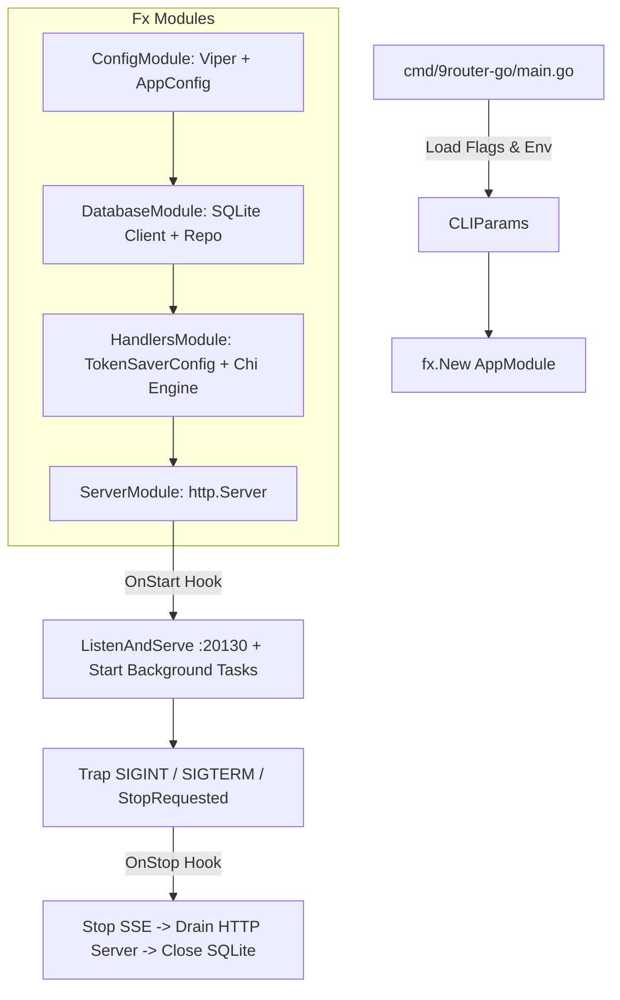
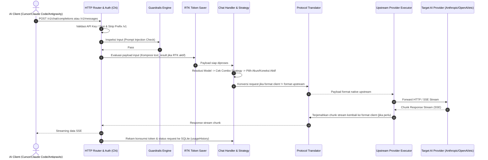

# Dokumentasi Codebase - 9router-go

## Metadata

| Field | Value |
|---|---|
| **Project** | 9router-go |
| **Module** | `9router/proxy` |
| **Bahasa** | Go (Go 1.22+ requirement, `go.mod` mendefinisikan `go 1.27` / toolchain `go1.27.3`) |
| **Frontend Tersemat** | Svelte 5 + Vite + Tailwind CSS (`web/`, di-embed via `web/embed.go`) |
| **Versi Rilis** | `v1.9.9` (terekam di `VERSION`, `version.json`, dan `internal/updater.CurrentVersion`) |
| **Database** | SQLite via `modernc.org/sqlite` (pure Go, WAL mode, auto-bootstrap schema) |
| **Upstream Baseline** | [`decolua/9router`](https://github.com/decolua/9router) v0.5.85 (kompatibilitas skema & protokol) |
| **Dokumentasi Date** | 2026-10-29 |
| **Status Verifikasi** | Audit kode sumber & file konfigurasi lokal (`cmd/`, `internal/`, `web/`, `go.mod`, `DATABASE.md`, `ARCHITECTURE.md`) |

---

## 1. Ringkasan Sistem

### 1.1 Purpose

`9router-go` adalah aplikasi reverse proxy dan router pintar untuk Artificial Intelligence (AI) Large Language Model (LLM) API yang dikemas dalam **satu binary Go mandiri** (*single binary*). Proyek ini menghilangkan ketergantungan runtime Node.js dari versi upstream (`decolua/9router`), menyediakan performa throughput tinggi, konsumsi memori rendah, serta menyematkan Web UI dashboard (Svelte 5) secara langsung ke dalam executable.

Sistem ini bertindak sebagai jembatan cerdas (*intelligent gateway*) antara tool AI lokal (seperti Claude Code, Cursor, Antigravity, OpenCode, Cline, VS Code Extension) dengan 40+ penyedia LLM (Anthropic, OpenAI, Gemini, DeepSeek, Grok, MiniMax, GLM, OpenRouter, Ollama, dan provider lokal kompatibel).

### 1.2 Fitur Utama

Berdasarkan audit kode pada paket `cmd/9router-go/` dan `internal/`:

1. **RTK Token Saver (`internal/tokensaver`)**:
   - Kompresi cerdas pada tool output panjang (seperti `git diff`, `git log`, `grep`, compiler error stacktrace, `npm/cargo/pip` install logs) yang menghemat 20–40% token input tanpa memangkas konteks kritis.
   - Pilihan persona/style teks keluaran terintegrasi: *Caveman* (terse), *Ponytail* (concise code), *ADHD* (action-first).
2. **Multi-tier & Auto-Fallback Routing (`internal/handlers/chat`, `internal/proxy`)**:
   - Skema fallback dinamis antar tier: *Subscription* (Claude Code / Copilot) → *Cheap* (GLM, MiniMax) → *Free* (Kiro, OpenCode Free, Vertex credits).
   - Mode combo routing: fallback, round-robin antar akun/koneksi, sticky session, capacity-based, dan fusion.
3. **Translasi Format Multi-Protocol (`internal/translator`)**:
   - Konversi payload request & streaming response dua arah yang mulus antara spesifikasi **OpenAI Chat Completions**, **Anthropic Messages API**, **Google Gemini API**, dan **Ollama Chat API**.
4. **Proxy & Tunneling Fleksibel (`internal/auth`, `internal/handlerutil`)**:
   - Binding proxy pool spesifik per API Key atau per koneksi provider, dengan mitigasi SSRF dan fallback sertifikat TLS.
5. **Guardrails & Security (`internal/guardrails`)**:
   - Pendeteksi prompt injection otomatis pada input prompt dan inspeksi audit respons outbound.
6. **Semantic Cache (`internal/handlers/chat`, `internal/db`)**:
   - Caching respons query berbasis semantik untuk mengurangi latensi dan menghemat pemanggilan model repetitif.
7. **Service & Daemon Management (`cmd/9router-go/`, `internal/service`, `internal/daemon`)**:
   - Dukungan autostart systemd user unit, launchd, OpenRC, background daemon detached (`--background` / `-d`), PID lifecycle tracking, dan hot reload.
8. **Observabilitas & Monitoring (`internal/observ`, `internal/handlers`)**:
   - Metrik Prometheus (`/metrics`), live console log streaming, chart pemakaian token/kuota per provider/model/API key.

### 1.3 Build, Run & Commands

```bash
# Menjalankan langsung di foreground
go run ./cmd/9router-go

# Menjalankan sebagai background daemon (detaches from terminal)
./9router-go --background
# atau
./9router-go start

# Memeriksa status, log, dan menghentikan daemon
./9router-go status
./9router-go logs -n 50
./9router-go stop
./9router-go restart

# Manajemen service OS (systemd/launchd/openrc)
./9router-go service install
./9router-go service status
./9router-go service start
./9router-go service stop

# Menjalankan test suite
go test ./internal/...
```

---

## 2. Struktur Project

```
plan/9router-go/
├── cmd/
│   ├── 9router-go/          # Entry point utama aplikasi CLI & HTTP proxy server
│   │   ├── main.go          # Definisi flag, urfave/cli app, signal trap
│   │   ├── commands.go      # Handler sub-command CLI (start, stop, status, restart)
│   │   ├── daemon_cmd.go    # Manajemen proses daemon latar belakang
│   │   ├── menu.go          # Menu terminal interaktif jika dijalankan di TTY
│   │   └── service_cmd.go   # Sub-command manajemen service sistem operasi
│   ├── 9router-tray/        # Aplikasi GUI desktop tray system
│   └── changelog-merge/     # Utility internal merger changelog
├── internal/
│   ├── app/                 # Dependency Injection container (Uber Fx) & server lifecycle
│   ├── auth/                # Otentikasi token CLI, session JWT, dan proxy tunneling
│   ├── clientconfig/        # Konfigurasi client per provider/model
│   ├── config/              # Viper loader, path resolver data/db, env bindings
│   ├── constants/           # Konstanta global, default timeout, header keys
│   ├── daemon/              # Detached process spawner & PID management
│   ├── db/                  # Driver SQLite (modernc.org/sqlite), schema bootstrap, repositori data
│   ├── fastjson/            # Utility parsing dan manipulasi JSON cepat
│   ├── guardrails/          # Engine proteksi prompt-injection & sanitasi stream
│   ├── handlers/            # Routing Chi HTTP dan handler domain:
│   │   ├── batches/         # Endpoint batch processing API
│   │   ├── chat/            # Routing model, combo, fallback, completions, messages
│   │   ├── dashboard/       # Dashboard APIs (settings, providers, keys, combos)
│   │   ├── media/           # Embeddings, image generations, audio TTS/STT
│   │   ├── oauth/           # Alur OAuth upstream (Gemini, Copilot, Antigravity, dll.)
│   │   ├── shared/          # TokenSaverConfig & tipe bersama handler
│   │   └── sso/             # Single Sign-On handler
│   ├── handlerutil/         # Response writer helper, buffer pool, proteksi SSRF
│   ├── keikey/              # Validasi dan caching API key
│   ├── middleware/          # Chi middlewares (Auth, CORS, RequestID, Recovery, Logging)
│   ├── modelhealth/         # Background loop pemantau kesehatan model & auto-ping
│   ├── observ/              # Registry metrik Prometheus, timer, dan histogram
│   ├── proc/                # Abstraksi proses OS cross-platform (POSIX & Windows)
│   ├── providers/           # Katalog model, capabilities, rate limits, alias mapping
│   ├── proxy/
│   │   ├── executor/        # Eksekutor upstream HTTP per provider & stream handler
│   │   └── oauth/           # Token refresher & callback listener OAuth
│   ├── schedule/            # Task scheduling periodik
│   ├── service/             # Supervisor autostart (systemd, launchd, openrc, cron)
│   ├── shutdown/            # Koordinasi graceful shutdown terpusat
│   ├── tokensaver/          # RTK engine, kompresor filter regex, rule JSON
│   ├── translator/          # Konversi request/response OpenAI <-> Claude <-> Gemini
│   ├── updater/             # Auto-update checker & binary patch installer
│   └── usagetracker/        # Parsing kuota dan tracking konsumsi token
├── web/                     # Sumber kode Web Dashboard SPA (Svelte 5, Vite)
│   └── embed.go             # Go `embed.FS` untuk menyematkan build output ke binary
├── .ai-doc/                 # Workspace dokumentasi arsitektur (ai-documentor)
│   ├── constitution.md      # Kontrak dokumentasi & aturan bukti
│   ├── 3p.md                # Progress tracker
│   └── Dokumentasi-Codebase.md # Dokumen arsitektur codebase ini
├── DATABASE.md              # Spesifikasi teknis skema SQLite & kontrak upstream
├── ARCHITECTURE.md          # Ikhtisar arsitektur Go runtime
└── go.mod                   # Deklarasi modul & daftar dependensi Go
```

---

## 3. Arsitektur Komponen

Komponen dalam sistem diklasifikasikan berdasarkan standar `ai-documentor`:

### 3.1 Tabel Pemetaan Komponen

| Komponen / Modul | Klasifikasi | Tanggung Jawab Utama | Traceability / File Acuan |
|---|---|---|---|
| **CLI & Commands** | `Boundary` | Parser argumen CLI, terminal menu, pemanggil sub-command daemon & service | [`cmd/9router-go/main.go`](file:///home/ubuntu/workspace/plan/9router-go/cmd/9router-go/main.go#L33-L75) |
| **HTTP Server & Chi Router** | `Boundary` | Listener HTTP, router Chi, normalisasi rute `/v1`, mounting rute domain | [`internal/handlers/router.go`](file:///home/ubuntu/workspace/plan/9router-go/internal/handlers/router.go#L36-L100) |
| **Auth & Security Middleware** | `Boundary` | Validasi Bearer token API key, proteksi cookie sesi JWT, proteksi SSRF | [`internal/middleware/`](file:///home/ubuntu/workspace/plan/9router-go/internal/middleware/), [`internal/auth/`](file:///home/ubuntu/workspace/plan/9router-go/internal/auth/) |
| **Web Dashboard SPA** | `Boundary` | Penyajian frontend statis Svelte 5 via `embed.FS` dengan index fallback | [`web/embed.go`](file:///home/ubuntu/workspace/plan/9router-go/web/embed.go) |
| **Chat & Routing Engine** | `Control` | Resolusi model, eksekusi strategi combo, failover antar-akun, seleksi provider | [`internal/handlers/chat/`](file:///home/ubuntu/workspace/plan/9router-go/internal/handlers/chat/) |
| **Protocol Translators** | `Control` | Konversi payload schema & stream SSE antara OpenAI, Claude Messages, dan Gemini | [`internal/translator/`](file:///home/ubuntu/workspace/plan/9router-go/internal/translator/) |
| **RTK Token Saver Engine** | `Control` | Deteksi & kompresi konten tool_result, strip whitespace/format output command | [`internal/tokensaver/`](file:///home/ubuntu/workspace/plan/9router-go/internal/tokensaver/) |
| **Guardrails Engine** | `Control` | Inspeksi prompt injection & verifikasi payload streaming keluar | [`internal/guardrails/engine.go`](file:///home/ubuntu/workspace/plan/9router-go/internal/guardrails/engine.go) |
| **Provider Upstream Executor** | `Control` | Pengiriman request HTTP TLS ke endpoint upstream AI, manajemen koneksi stream | [`internal/proxy/executor/`](file:///home/ubuntu/workspace/plan/9router-go/internal/proxy/executor/) |
| **Model Health Loop** | `Control` | Background pinger untuk validasi ketersediaan akun/model & manajemen status cooldown | [`internal/modelhealth/loop.go`](file:///home/ubuntu/workspace/plan/9router-go/internal/modelhealth/loop.go) |
| **Service & Daemon Controller**| `Control` | Pengaturan lifecycle background process, detasemen proses, integrasi systemd | [`internal/daemon/`](file:///home/ubuntu/workspace/plan/9router-go/internal/daemon/), [`internal/service/`](file:///home/ubuntu/workspace/plan/9router-go/internal/service/) |
| **Data Models & DTOs** | `Entity` | Struktur data connection, model config, API key, combo, usage history | [`internal/db/`](file:///home/ubuntu/workspace/plan/9router-go/internal/db/), [`internal/providers/`](file:///home/ubuntu/workspace/plan/9router-go/internal/providers/) |
| **API Endpoints (Semua rute)** | `Entity` | Kontrak endpoint REST & SSE (`/v1/chat/completions`, `/v1/messages`, `/models`, dll.) | [`internal/handlers/router.go`](file:///home/ubuntu/workspace/plan/9router-go/internal/handlers/router.go#L60-L100) |
| **SQLite Database Client** | `Infrastructure` | Driver database SQLite (`modernc.org/sqlite`), pooling koneksi, migrasi skema | [`internal/db/client.go`](file:///home/ubuntu/workspace/plan/9router-go/internal/db/client.go), [`internal/db/schema.go`](file:///home/ubuntu/workspace/plan/9router-go/internal/db/schema.go) |
| **Uber Fx App Lifecycle** | `Infrastructure` | Dependency Injection container yang mengelola lifecycle startup & shutdown | [`internal/app/app.go`](file:///home/ubuntu/workspace/plan/9router-go/internal/app/app.go#L16-L45) |
| **Observability (Prometheus)** | `Infrastructure` | Registrasi metrik sistem, latency histogram, hit counter, monitoring endpoint | [`internal/observ/metrics.go`](file:///home/ubuntu/workspace/plan/9router-go/internal/observ/metrics.go) |

---

## 4. Runtime & Key Execution Flows

### 4.1 Inisialisasi Aplikasi (Uber Fx Lifecycle)

Arsitektur aplikasi dibangun di atas Uber Fx (`go.uber.org/fx`):



- **Startup Budget**: Maksimal 15 detik untuk memvalidasi skema database, menyinkronkan katalog model, dan membuka listener socket.
- **Shutdown Budget**: Maksimal 20 detik total; 5 detik dialokasikan untuk menyelesaikan in-flight HTTP streams sebelum socket ditutup dan koneksi SQLite di-close secara aman.

### 4.2 Alur Eksekusi Proxy Chat Request



### 4.3 Alur Failover & Combo Strategy

Jika sebuah request gagal di level upstream (misalnya mendapatkan kode status HTTP `429 Too Many Requests`, `401 Unauthorized` karena token kedaluwarsa, atau `5xx Server Error`):
1. **Cooldown Tracking**: Akun provider yang gagal dimasukkan ke status cooldown sementara di dalam memori/database.
2. **Next Account / Next Tier**:
   - Jika combo bertipe `fallback`, engine segera mencoba akun berikutnya dalam combo tersebut.
   - Jika semua akun pada provider utama habis, permintaan dialihkan ke tier provider cadangan (*Subscription → Cheap → Free*).
3. **Force Fallback**: Bila flag `FORCE_FALLBACK_ON_ALL_UNAVAILABLE=true` aktif, engine memilih akun yang waktu cooldown-nya paling cepat selesai daripada langsung menolak request.

---

## 5. Database & Penyimpanan Data

`9router-go` menggunakan database relasional berbasis file **SQLite** melalui library `modernc.org/sqlite` (implementasi pure Go CGO-free).

### 5.1 Resolusi Lokasi File Database

1. Menggunakan nilai environment variable `DB_PATH` bila disetel.
2. Default path bila tidak disetel:
   - **Linux / macOS**: `$DATA_DIR/db/data.sqlite` atau `~/.9router/db/data.sqlite`.
   - **Windows**: `%APPDATA%\9router\db\data.sqlite`.
3. SQLite dikonfigurasi dengan:
   - Mode Journal: `WAL` (Write-Ahead Logging)
   - `synchronous = NORMAL`
   - Foreign Keys: `ON`
   - Busy Timeout: 5 detik
   - Batas maksimum koneksi terbuka: 4 koneksi

### 5.2 Skema Tabel Utama

| Nama Tabel | Peran & Isi Data |
|---|---|
| `settings` | Konfigurasi sistem global (disimpan sebagai JSON pada row `id=1`), termasuk hash password admin dan preferensi fitur. |
| `_meta` | Metadata versi skema database (`schemaVersion = '1'`). |
| `providerConnections` | Kredensial dan metadata akun provider upstream (API key, OAuth token, email, prioritas, status aktif). |
| `providerNodes` | Node/endpoint kustom kompatibel pihak ketiga. |
| `proxyPools` | Definisi pool proxy outbound untuk routing koneksi tertentu. |
| `apiKeys` | Kunci otentikasi yang diterbitkan oleh 9router-go untuk client lokal. |
| `combos` | Definisi grup model gabungan (combo) beserta urutan strategi fallback dan bobotnya. |
| `kv` | Key-value store fleksibel untuk status runtime dan konfigurasi ad-hoc. |
| `usageHistory` | Catatan audit historis per transaksi request (model, provider, jumlah token input/output, latensi, status). |
| `usageDaily` | Agregasi harian pemakaian token untuk kebutuhan analitik dashboard cepat. |
| `requestDetails` | Detail payload request & response untuk inspeksi debugging mendalam di dashboard. |
| `upstream_leases` | Tabel internal Go untuk koordinasi sewa koneksi upstream antar-goroutine. |

---

## 6. Konfigurasi & Environment Variables

Konfigurasi dimuat melalui Viper (`internal/config/config.go`) dari file `.env` dan environment variables sistem operasi:

| Environment Variable | Default | Keterangan |
|---|---|---|
| `PORT` | `20130` | Port listener HTTP server lokal. |
| `DATA_DIR` | `~/.9router` (POSIX) | Direktori root penyimpanan database, file PID, dan run logs. |
| `DB_PATH` | (Otomatis dari `DATA_DIR`) | Override langsung path ke file SQLite `data.sqlite`. |
| `JWT_SECRET` | Auto-generated jika kosong | Secret key untuk penandatanganan cookie JWT sesi dashboard. |
| `INITIAL_PASSWORD` | `123456` | Password default login awal dashboard admin. |
| `RTK_ENABLED` | `true` | Mengaktifkan optimasi kompresi token RTK secara default. |
| `CAVEMAN_ENABLED` | `false` | Mengaktifkan output teks bergaya Caveman (terse). |
| `PONYTAIL_ENABLED` | `false` | Mengaktifkan output teks bergaya Ponytail (lazy dev code). |
| `ADHD_ENABLED` | `false` | Mengaktifkan mode ADHD (action-first text style). |
| `INJECTION_GUARD_DISABLED` | `false` | Menonaktifkan detektor prompt injection jika disetel ke `true`. |
| `AUTO_UPDATE` | `false` | Mengaktifkan pengecekan dan instalasi update otomatis. |
| `HTTP_PROXY` / `HTTPS_PROXY` | `""` | Proxy HTTP/HTTPS upstream default bila diperlukan. |
| `FORCE_FALLBACK_ON_ALL_UNAVAILABLE` | `false` | Paksa fallback ke akun cooldown tercepat jika semua akun sibuk. |
| `STRICT_SSL` | `false` | Jika `false`, mengizinkan retry tanpa TLS verify bila sertifikat korporat bermasalah. |
| `FX_LOGGING` | `false` | Jika `true`, mencetak log internal dependency injection Uber Fx ke stderr. |

---

## 7. Observabilitas, Logging & Keamanan

1. **Prometheus Metrics**:
   - Endpoint: `/metrics`
   - Melaporkan counter total request, status kode HTTP, durasi latensi eksekusi per provider, dan konsumsi token.
2. **Structured & Live Console Logging**:
   - Log aplikasi dicatat secara terstruktur dengan level (`DEBUG`, `INFO`, `WARN`, `ERROR`).
   - Ketika dijalankan sebagai background daemon, log dialihkan ke file `$DATA_DIR/run/gateway.log` dan dapat dipantau via `./9router-go logs`.
   - Web UI Dashboard menyediakan live log streaming via endpoint `/api/logs`.
3. **Keamanan & Sandboxing**:
   - Proteksi SSRF (`internal/handlerutil/ssrf.go`) mencegah redirect atau pemanggilan ke alamat loopback/internal yang berbahaya dari input pengguna.
   - Pemisahan hak akses: API key client hanya memiliki akses ke rute proxy (`/v1/...`), sedangkan konfigurasi provider dan dashboard memerlukan autentikasi sesi JWT admin.

---

## 8. Status Verifikasi & Rekomendasi Lanjutan

### 8.1 Verifikasi yang Telah Dilakukan
- [x] Verifikasi kelengkapan source code Go di direktori `cmd/`, `internal/`, dan `web/`.
- [x] Audit definisi rute Chi dan pencocokan dengan spesifikasi OpenAI & Anthropic Claude.
- [x] Verifikasi skema database dan mekanisme auto-bootstrap SQLite di `internal/db/schema.go`.
- [x] Audit implementasi lifecycle Uber Fx dan sinyal graceful shutdown POSIX/Windows.

### 8.2 Artefak Lanjutan (Sesuai Aturan *Only-On-Request*)
Sesuai konstitusi, artefak berikut tidak dibuat otomatis dan dapat diminta terpisah jika diperlukan:
- **Dokumentasi Fitur (`Dokumentasi-Fitur.md`)**: Inventaris status detail seluruh fitur (aktif, terencana, atau parsial).
- **Spesifikasi REST API (`rest-api-doc/`)**: Dokumen endpoint list lengkap dan detail kontrak input/output per endpoint.
- **Desain Database Komprehensif (`desain-database-document/`)**: Diagram ERD Mermaid lengkap dan kamus data (*Data Dictionary*) per tabel.
- **Desain Komponen Detail (`desain-component-document/`)**: Dokumen DCD untuk modul tertentu (misalnya RTK Token Saver atau Translators).

