# Dokumentasi Komponen dan Use Case

## 1. Ringkasan
Dokumen ini mengelompokkan komponen fungsional di dalam **9router-go** (`v1.9.9`) berdasarkan arsitektur paket Go aktual, lalu menurunkan daftar use case yang memiliki jejak implementasi nyata pada boundary HTTP router, CLI command, service handler, repository SQLite, maupun background worker.

Dokumen ini memakai tiga status:
- `Ada`: boundary dan alur use case terlihat jelas dan terhubung end-to-end di codebase aktif.
- `Parsial`: terdapat handler atau hook konfigurasi, tetapi bergantung pada proses eksternal opsional atau lingkungan OS tertentu.
- `Belum terlihat jelas`: belum ditemukan boundary aktif yang cukup untuk menyatakan fitur tersebut berjalan penuh.

Catatan validitas:
- Seluruh komponen dan use case diturunkan langsung dari pemeriksaan kode pada `cmd/9router-go/`, `cmd/9router-tray/`, `internal/handlers/router.go`, dan sub-paket di bawah `internal/`.
- Penamaan komponen dan use case di dokumen ini menjadi acuan tunggal untuk diagram PlantUML di Seksi 2, rincian di Seksi 3, serta dokumen desain komponen (`DCD-01` s/d `DCD-08`).

## 2. Diagram Use Case Tergrup

```plantuml
@startuml
left to right direction
skinparam packageStyle rectangle
skinparam monochrome false

actor "AI Coding / SDK Client" as AIClient
actor "Operator / Admin" as Operator
actor "Background Scheduler / OS" as SystemActor
actor "Upstream AI & OAuth Provider" as UpstreamProvider

package "AI Gateway & Protocol Translator" {
  usecase "Eksekusi Inferensi Chat & Messages Lintas Protokol" as UC_GW_1
  usecase "Eksekusi OpenAI Responses API & Compact" as UC_GW_2
  usecase "Translasi Payload, Tool Schema, & Stream SSE" as UC_GW_3
  usecase "Normalisasi Thinking & Reasoning Effort" as UC_GW_4
}

package "Smart Routing & Model Catalog" {
  usecase "Resolusi Model & Eksekusi Strategi Combo" as UC_SR_1
  usecase "Generate Auto-Free, Auto-Family, & Smart Combo Rules" as UC_SR_2
  usecase "Sinkronisasi & Kueri Katalog Model Upstream" as UC_SR_3
  usecase "Kelola Custom Model, Alias, & Auto-Disable" as UC_SR_4
  usecase "Jalankan Probe Kesehatan Model Otomatis" as UC_SR_5
}

package "RTK Token Saver & Prompt Engine" {
  usecase "Kompresi Output Tool CLI dengan Filter RTK" as UC_TS_1
  usecase "Injeksi Gaya Output Persona (Caveman, Ponytail, ADHD)" as UC_TS_2
  usecase "Kelola & Simulasikan Preset Prompt Jailbreak per Model" as UC_TS_3
  usecase "Uji Filter Kompresi & Pantau Analitik Penghematan Token" as UC_TS_4
}

package "Provider Connections, OAuth & Proxy Pools" {
  usecase "Kelola Koneksi Akun Provider & Prioritas Failover" as UC_PO_1
  usecase "Otorisasi OAuth Multi-Vendor & Impor Sesi Browser" as UC_PO_2
  usecase "Kelola Custom Provider Nodes & Batas Kapasitas Node" as UC_PO_3
  usecase "Kelola Outbound Proxy Pools & Deploy Serverless Relay" as UC_PO_4
}

package "Multimodal Media, Web Tools & Batches" {
  usecase "Proses Embeddings, Image, Audio TTS/STT, & Video" as UC_MM_1
  usecase "Jalankan Utilitas Web Search, Scrape, & Fetch" as UC_MM_2
  usecase "Kelola Antrean Files & OpenAI Batch API" as UC_MM_3
  usecase "Kelola Proses Sidecar Kompresi Headroom" as UC_MM_4
}

package "Guardrails, Security & Rate Limiting" {
  usecase "Inspeksi Prompt Injection Inbound & Filter Outbound" as UC_GS_1
  usecase "Kelola API Key Klien, Model Allowlist, & Kuota" as UC_GS_2
  usecase "Tegakkan Rate Limit Sliding-Window & Tier Plan" as UC_GS_3
  usecase "Kelola Autentikasi Sesi Dashboard, SSO OIDC/SAML, & Vault" as UC_GS_4
}

package "Semantic Cache, Usage Analytics & Observability" {
  usecase "Layani & Kelola Entri Persistent Semantic Cache" as UC_CO_1
  usecase "Pantau Stream Topologi Real-Time & Statistik Penggunaan" as UC_CO_2
  usecase "Inspeksi Detail Payload Request & Lacak Kuota Provider" as UC_CO_3
  usecase "Ekspos Metrik Prometheus, Debug Traces, & Live Console Logs" as UC_CO_4
}

package "CLI Tools, Daemon & Service Controller" {
  usecase "Konfigurasi Otomatis 10 Agen Coding CLI Lokal" as UC_CD_1
  usecase "Kelola Siklus Hidup Background Daemon & Service OS" as UC_CD_2
  usecase "Kelola Backup, Prune, & Vacuum Database SQLite" as UC_CD_3
  usecase "Kelola Eksposur Tunnel, Tailscale, & Self-Updater" as UC_CD_4
}

AIClient --> UC_GW_1
AIClient --> UC_GW_2
AIClient --> UC_SR_3
AIClient --> UC_MM_1
AIClient --> UC_MM_2
AIClient --> UC_MM_3

Operator --> UC_SR_1
Operator --> UC_SR_2
Operator --> UC_SR_4
Operator --> UC_TS_3
Operator --> UC_TS_4
Operator --> UC_PO_1
Operator --> UC_PO_2
Operator --> UC_PO_3
Operator --> UC_PO_4
Operator --> UC_MM_4
Operator --> UC_GS_1
Operator --> UC_GS_2
Operator --> UC_GS_3
Operator --> UC_GS_4
Operator --> UC_CO_1
Operator --> UC_CO_2
Operator --> UC_CO_3
Operator --> UC_CO_4
Operator --> UC_CD_1
Operator --> UC_CD_2
Operator --> UC_CD_3
Operator --> UC_CD_4

SystemActor --> UC_SR_3
SystemActor --> UC_SR_5
SystemActor --> UC_CD_2
SystemActor --> UC_CD_4

UC_GW_1 ..> UC_GS_1 : <<include>>
UC_GW_1 ..> UC_GS_3 : <<include>>
UC_GW_1 ..> UC_TS_1 : <<extend>>
UC_GW_1 ..> UC_TS_2 : <<extend>>
UC_GW_1 ..> UC_SR_1 : <<include>>
UC_GW_1 ..> UC_GW_3 : <<include>>
UC_GW_1 ..> UC_GW_4 : <<extend>>
UC_GW_1 ..> UC_CO_1 : <<extend>>
UC_GW_1 --> UpstreamProvider
UC_PO_2 --> UpstreamProvider
@enduml
```

## 3. Daftar Use Case per Komponen

### 3.1 AI Gateway & Protocol Translator
**Status**: ✅ **Active**  
**Reference**: `DCD-01-AI-Gateway-and-Protocol-Translator.md`

Deskripsi:
Komponen ini merupakan inti pemrosesan data plane yang menjembatani perbedaan protokol antara aplikasi klien (OpenAI, Anthropic, Ollama) dan puluhan API provider upstream. Keunggulan utamanya terletak pada kemampuan mengubah struktur request, definisi tool, serta frame streaming SSE secara on-the-fly tanpa mengharuskan klien mengubah SDK mereka.

Use case yang terverifikasi:
- ✅ `Eksekusi Inferensi Chat & Messages Lintas Protokol` (UC-GW-1, **Active** / `Ada`)
- ✅ `Eksekusi OpenAI Responses API & Compact` (UC-GW-2, **Active** / `Ada`)
- ✅ `Translasi Payload, Tool Schema, & Stream SSE` (UC-GW-3, **Active** / `Ada`)
- ✅ `Normalisasi Thinking & Reasoning Effort` (UC-GW-4, **Active** / `Ada`)

Bukti kode:
- [`internal/handlers/router.go`](file:///home/ubuntu/workspace/plan/9router-go/internal/handlers/router.go#L61-L87)
- [`internal/handlers/chat/`](file:///home/ubuntu/workspace/plan/9router-go/internal/handlers/chat/)
- [`internal/translator/request.go`](file:///home/ubuntu/workspace/plan/9router-go/internal/translator/request.go)
- [`internal/translator/gemini.go`](file:///home/ubuntu/workspace/plan/9router-go/internal/translator/gemini.go)
- [`internal/translator/antigravity.go`](file:///home/ubuntu/workspace/plan/9router-go/internal/translator/antigravity.go)
- [`internal/translator/responses_json.go`](file:///home/ubuntu/workspace/plan/9router-go/internal/translator/responses_json.go)
- [`internal/providers/thinking_levels.go`](file:///home/ubuntu/workspace/plan/9router-go/internal/providers/thinking_levels.go)
- [`internal/proxy/executor/`](file:///home/ubuntu/workspace/plan/9router-go/internal/proxy/executor/)

Implementasi:
- Menggunakan `encoding/json/v2` dan pool buffer di `internal/handlerutil/buffer_pool.go` untuk meminimalkan alokasi memori saat mem-parsing dan menulis ulang stream SSE berkecepatan tinggi.
- Mendeteksi fingerprint klien (`client_identity.go`, `cline_identity.go`, `zed.go`) untuk menyertakan header beta khusus dan mengatasi ketidakcocokan skema JSON Schema tool antar vendor.

---

### 3.2 Smart Routing & Model Catalog
**Status**: ✅ **Active**  
**Reference**: `DCD-02-Smart-Routing-and-Model-Catalog.md`

Deskripsi:
Komponen ini bertanggung jawab atas kecerdasan pemilihan rute, pengelompokan model virtual (*Combos*), manajemen katalog kapabilitas model, serta pemantauan kesehatan model di latar belakang. Komponen ini memastikan kontinuitas layanan dengan mengalihkan trafik secara otomatis ketika suatu akun atau provider mengalami gangguan atau kehabisan kuota.

Use case yang terverifikasi:
- ✅ `Resolusi Model & Eksekusi Strategi Combo` (UC-SR-1, **Active** / `Ada`)
- ✅ `Generate Auto-Free, Auto-Family, & Smart Combo Rules` (UC-SR-2, **Active** / `Ada`)
- ✅ `Sinkronisasi & Kueri Katalog Model Upstream` (UC-SR-3, **Active** / `Ada`)
- ✅ `Kelola Custom Model, Alias, & Auto-Disable` (UC-SR-4, **Active** / `Ada`)
- ✅ `Jalankan Probe Kesehatan Model Otomatis` (UC-SR-5, **Active** / `Ada`)

Bukti kode:
- [`internal/handlers/router.go`](file:///home/ubuntu/workspace/plan/9router-go/internal/handlers/router.go#L63-L75)
- [`internal/handlers/router.go`](file:///home/ubuntu/workspace/plan/9router-go/internal/handlers/router.go#L271-L288)
- [`internal/handlers/router.go`](file:///home/ubuntu/workspace/plan/9router-go/internal/handlers/router.go#L329-L354)
- [`internal/providers/registry_models.go`](file:///home/ubuntu/workspace/plan/9router-go/internal/providers/registry_models.go)
- [`internal/providers/catalog_sync.go`](file:///home/ubuntu/workspace/plan/9router-go/internal/providers/catalog_sync.go)
- [`internal/providers/aliases.go`](file:///home/ubuntu/workspace/plan/9router-go/internal/providers/aliases.go)
- [`internal/providers/errorclassify.go`](file:///home/ubuntu/workspace/plan/9router-go/internal/providers/errorclassify.go)
- [`internal/modelhealth/loop.go`](file:///home/ubuntu/workspace/plan/9router-go/internal/modelhealth/loop.go)

Implementasi:
- Loop kesehatan model (`internal/modelhealth/loop.go`) terhubung langsung ke instance tunggal `ChatHandler` yang sama dengan router utama agar setiap ping menggunakan kredensial dan token refresh yang identik dengan trafik produksi.
- Indeks pola model (`modelpattern.go`) menggunakan pencocokan glob berprioritas agar aturan spesifik tidak tertimpa oleh wildcard umum.

---

### 3.3 RTK Token Saver & Prompt Engine
**Status**: ✅ **Active**  
**Reference**: `DCD-03-RTK-Token-Saver-and-Prompt-Engine.md`

Deskripsi:
Komponen ini memodifikasi dan mengoptimalkan isi pesan sebelum dikirim ke provider LLM untuk menekan konsumsi token sebesar 20–40%. Selain kompresi deterministik pada hasil eksekusi tool CLI, komponen ini menyediakan injeksi instruksi persona hemat token serta pengelolaan preset sistem (*Jailbreak*) per model.

Use case yang terverifikasi:
- ✅ `Kompresi Output Tool CLI dengan Filter RTK` (UC-TS-1, **Active** / `Ada`)
- ✅ `Injeksi Gaya Output Persona (Caveman, Ponytail, ADHD)` (UC-TS-2, **Active** / `Ada`)
- ✅ `Kelola & Simulasikan Preset Prompt Jailbreak per Model` (UC-TS-3, **Active** / `Ada`)
- ✅ `Uji Filter Kompresi & Pantau Analitik Penghematan Token` (UC-TS-4, **Active** / `Ada`)

Bukti kode:
- [`internal/tokensaver/rtk.go`](file:///home/ubuntu/workspace/plan/9router-go/internal/tokensaver/rtk.go)
- [`internal/tokensaver/filters.go`](file:///home/ubuntu/workspace/plan/9router-go/internal/tokensaver/filters.go)
- [`internal/tokensaver/filters/`](file:///home/ubuntu/workspace/plan/9router-go/internal/tokensaver/filters/)
- [`internal/tokensaver/prompts.go`](file:///home/ubuntu/workspace/plan/9router-go/internal/tokensaver/prompts.go)
- [`internal/tokensaver/caveman.go`](file:///home/ubuntu/workspace/plan/9router-go/internal/tokensaver/caveman.go)
- [`internal/tokensaver/preserve.go`](file:///home/ubuntu/workspace/plan/9router-go/internal/tokensaver/preserve.go)
- [`internal/handlers/router.go`](file:///home/ubuntu/workspace/plan/9router-go/internal/handlers/router.go#L228-L250)
- [`internal/handlers/router.go`](file:///home/ubuntu/workspace/plan/9router-go/internal/handlers/router.go#L378-L380)

Implementasi:
- Menyematkan 48 file definisi filter JSON di `internal/tokensaver/filters/` yang dipetakan berdasarkan nama komando shell/tool, dengan guard khusus (`preserve.go`, `read_numbered.go`) agar nomor baris kode dan angka tidak rusak saat pemangkasan.
- Memotong teks pada batas karakter UTF-8 yang aman dan menjaga keutuhan struktur JSON bila output tool terdeteksi sebagai objek terstruktur.

---

### 3.4 Provider Connections, OAuth & Proxy Pools
**Status**: ✅ **Active**  
**Reference**: `DCD-04-Provider-Connections-OAuth-and-Proxy-Pools.md`

Deskripsi:
Komponen ini menangani siklus hidup autentikasi ke 40+ provider AI eksternal, manajemen banyak akun per vendor, penambahan endpoint kustom, serta perutean koneksi keluar melalui pool proxy atau relay serverless. Komponen ini menyederhanakan proses login yang rumit (seperti loopback OAuth, PKCE, Device Code, hingga impor cookie Chrome) menjadi alur terpadu di dashboard.

Use case yang terverifikasi:
- ✅ `Kelola Koneksi Akun Provider & Prioritas Failover` (UC-PO-1, **Active** / `Ada`)
- ✅ `Otorisasi OAuth Multi-Vendor & Impor Sesi Browser` (UC-PO-2, **Active** / `Ada`)
- ✅ `Kelola Custom Provider Nodes & Batas Kapasitas Node` (UC-PO-3, **Active** / `Ada`)
- ✅ `Kelola Outbound Proxy Pools & Deploy Serverless Relay` (UC-PO-4, **Active** / `Ada`)

Bukti kode:
- [`internal/handlers/router.go`](file:///home/ubuntu/workspace/plan/9router-go/internal/handlers/router.go#L187-L205)
- [`internal/handlers/router.go`](file:///home/ubuntu/workspace/plan/9router-go/internal/handlers/router.go#L252-L270)
- [`internal/handlers/router.go`](file:///home/ubuntu/workspace/plan/9router-go/internal/handlers/router.go#L290-L305)
- [`internal/handlers/router.go`](file:///home/ubuntu/workspace/plan/9router-go/internal/handlers/router.go#L425-L472)
- [`internal/handlers/oauth/`](file:///home/ubuntu/workspace/plan/9router-go/internal/handlers/oauth/)
- [`internal/proxy/oauth/`](file:///home/ubuntu/workspace/plan/9router-go/internal/proxy/oauth/)
- [`internal/providers/oauth.go`](file:///home/ubuntu/workspace/plan/9router-go/internal/providers/oauth.go)

Implementasi:
- Untuk provider dengan redirect URI loopback tetap seperti OpenAI Codex, komponen membuka listener HTTP sementara pada port khusus (`codex_proxy.go`) dengan batas `ReadHeaderTimeout` 10 detik dan menutupnya segera setelah pertukaran token selesai.
- Menggunakan tabel SQLite `upstream_leases` untuk mengoordinasikan penyegaran token OAuth dan pemakaian koneksi antar-goroutine agar tidak terjadi race condition.

---

### 3.5 Multimodal Media, Web Tools & Batches
**Status**: ✅ **Active**  
**Reference**: `DCD-05-Multimodal-Media-Web-Tools-and-Batches.md`

Deskripsi:
Komponen ini memperluas kapabilitas gateway di luar percakapan teks menuju layanan multimodal (embedding, gambar, audio TTS/STT/musik, video), peralatan akses web bagi agen AI, manajemen proses sidecar *Headroom*, serta antrean pemrosesan asinkron kompatibel OpenAI Batch API.

Use case yang terverifikasi:
- ✅ `Proses Embeddings, Image, Audio TTS/STT, & Video` (UC-MM-1, **Active** / `Ada`)
- ✅ `Jalankan Utilitas Web Search, Scrape, & Fetch` (UC-MM-2, **Active** / `Ada`)
- ✅ `Kelola Antrean Files & OpenAI Batch API` (UC-MM-3, **Active** / `Ada`)
- ⏳ `Kelola Proses Sidecar Kompresi Headroom` (UC-MM-4, **Parsial** — membutuhkan instalasi biner/lingkungan Headroom di host)

Bukti kode:
- [`internal/handlers/router.go`](file:///home/ubuntu/workspace/plan/9router-go/internal/handlers/router.go#L81-L110)
- [`internal/handlers/router.go`](file:///home/ubuntu/workspace/plan/9router-go/internal/handlers/router.go#L124-L144)
- [`internal/handlers/router.go`](file:///home/ubuntu/workspace/plan/9router-go/internal/handlers/router.go#L627-L651)
- [`internal/handlers/media/`](file:///home/ubuntu/workspace/plan/9router-go/internal/handlers/media/)
- [`internal/handlers/batches/`](file:///home/ubuntu/workspace/plan/9router-go/internal/handlers/batches/)

Implementasi:
- Handler media menerima instance `ChatHandler` aktif agar fitur pengujian model (`/api/models/test` dan `/api/combos/{id}/test-models`) melewati jalur resolusi kredensial dan eksekutor yang sama dengan trafik chat utama.
- Pengambilan URL eksternal pada fitur media/web dilengkapi validasi SSRF (`internal/handlerutil/ssrf.go`) untuk menolak akses ke IP loopback, link-local, dan subnet privat.

---

### 3.6 Guardrails, Security & Rate Limiting
**Status**: ✅ **Active**  
**Reference**: `DCD-06-Guardrails-Security-and-Rate-Limiting.md`

Deskripsi:
Komponen ini menyelubungi seluruh endpoint dengan lapisan kontrol akses berlapis, pembatasan laju trafik (*rate limiting*) per kunci API maupun tier paket langganan (*Plans*), deteksi serangan prompt injection, enkripsi kredensial di database, serta integrasi Single Sign-On perusahaan.

Use case yang terverifikasi:
- ✅ `Inspeksi Prompt Injection Inbound & Filter Outbound` (UC-GS-1, **Active** / `Ada`)
- ✅ `Kelola API Key Klien, Model Allowlist, & Kuota` (UC-GS-2, **Active** / `Ada`)
- ✅ `Tegakkan Rate Limit Sliding-Window & Tier Plan` (UC-GS-3, **Active** / `Ada`)
- ✅ `Kelola Autentikasi Sesi Dashboard, SSO OIDC/SAML, & Vault` (UC-GS-4, **Active** / `Ada`)

Bukti kode:
- [`internal/guardrails/engine.go`](file:///home/ubuntu/workspace/plan/9router-go/internal/guardrails/engine.go)
- [`internal/guardrails/middleware.go`](file:///home/ubuntu/workspace/plan/9router-go/internal/guardrails/middleware.go)
- [`internal/guardrails/outbound.go`](file:///home/ubuntu/workspace/plan/9router-go/internal/guardrails/outbound.go)
- [`internal/middleware/`](file:///home/ubuntu/workspace/plan/9router-go/internal/middleware/)
- [`internal/keikey/apikey.go`](file:///home/ubuntu/workspace/plan/9router-go/internal/keikey/apikey.go)
- [`internal/auth/session.go`](file:///home/ubuntu/workspace/plan/9router-go/internal/auth/session.go)
- [`internal/handlers/sso/`](file:///home/ubuntu/workspace/plan/9router-go/internal/handlers/sso/)
- [`internal/handlers/router.go`](file:///home/ubuntu/workspace/plan/9router-go/internal/handlers/router.go#L306-L328)
- [`internal/handlers/router.go`](file:///home/ubuntu/workspace/plan/9router-go/internal/handlers/router.go#L593-L625)

Implementasi:
- Urutan middleware di `SetupServerRouter` dirancang ketat: `RequireApiKey` → `RequireRateLimit` → `guardrails.Inbound`, sehingga request yang sudah ditolak karena kunci tidak valid atau melampaui batas RPM/TPM tidak akan membebani CPU untuk pemindaian konten guardrail.
- Sakelar utama guardrail (`guardrailSwitch`) membaca status aktif dari tabel `settings` per request sehingga operator dapat mematikan guardrail seketika tanpa menghapus kebijakan yang tersimpan.

---

### 3.7 Semantic Cache, Usage Analytics & Observability
**Status**: ✅ **Active**  
**Reference**: `DCD-07-Semantic-Cache-Usage-Analytics-and-Observability.md`

Deskripsi:
Komponen ini menyediakan visibilitas operasional menyeluruh dan percepatan respons melalui semantic cache persisten. Seluruh transaksi inferensi dicatat ke dalam riwayat penggunaan untuk disajikan sebagai grafik analitik, animasi topologi SSE real-time, inspeksi payload mentah, pelacakan sisa kuota provider, hingga metrik Prometheus.

Use case yang terverifikasi:
- ✅ `Layani & Kelola Entri Persistent Semantic Cache` (UC-CO-1, **Active** / `Ada`)
- ✅ `Pantau Stream Topologi Real-Time & Statistik Penggunaan` (UC-CO-2, **Active** / `Ada`)
- ✅ `Inspeksi Detail Payload Request & Lacak Kuota Provider` (UC-CO-3, **Active** / `Ada`)
- ✅ `Ekspos Metrik Prometheus, Debug Traces, & Live Console Logs` (UC-CO-4, **Active** / `Ada`)

Bukti kode:
- [`internal/handlers/router.go`](file:///home/ubuntu/workspace/plan/9router-go/internal/handlers/router.go#L148-L165)
- [`internal/handlers/router.go`](file:///home/ubuntu/workspace/plan/9router-go/internal/handlers/router.go#L221-L226)
- [`internal/handlers/router.go`](file:///home/ubuntu/workspace/plan/9router-go/internal/handlers/router.go#L414-L423)
- [`internal/handlers/usage_stats.go`](file:///home/ubuntu/workspace/plan/9router-go/internal/handlers/usage_stats.go)
- [`internal/handlers/usage_chart.go`](file:///home/ubuntu/workspace/plan/9router-go/internal/handlers/usage_chart.go)
- [`internal/handlers/usage_window_cache.go`](file:///home/ubuntu/workspace/plan/9router-go/internal/handlers/usage_window_cache.go)
- [`internal/handlers/consolelog.go`](file:///home/ubuntu/workspace/plan/9router-go/internal/handlers/consolelog.go)
- [`internal/usagetracker/tracker.go`](file:///home/ubuntu/workspace/plan/9router-go/internal/usagetracker/tracker.go)
- [`internal/observ/metrics.go`](file:///home/ubuntu/workspace/plan/9router-go/internal/observ/metrics.go)

Implementasi:
- Instance `SemanticCache` dibagi secara eksplisit antara `ChatHandler` (data plane) dan `DashboardHandler` (control plane) agar penghapusan atau pembacaan cache dari UI langsung memengaruhi memori LRU yang sedang melayani trafik.
- Kueri analitik rentang waktu kustom (`usage_window_cache.go`) menggunakan struktur cache jendela waktu di memori untuk menghindari pemindaian tabel `usageHistory` berulang kali pada setiap refresh halaman dashboard.

---

### 3.8 CLI Tools, Daemon & Service Controller
**Status**: ✅ **Active**  
**Reference**: `DCD-08-CLI-Tools-Daemon-and-Service-Controller.md`

Deskripsi:
Komponen ini mengelola integrasi dengan lingkungan host operator, mulai dari penulisan konfigurasi otomatis untuk 10 aplikasi CLI coding, eksekusi proses daemon di latar belakang, instalasi service autostart lintas sistem operasi, pemeliharaan file database SQLite, integrasi jaringan Tunnel/Tailscale, hingga pembaruan biner otomatis.

Use case yang terverifikasi:
- ✅ `Konfigurasi Otomatis 10 Agen Coding CLI Lokal` (UC-CD-1, **Active** / `Ada`)
- ✅ `Kelola Siklus Hidup Background Daemon & Service OS` (UC-CD-2, **Active** / `Ada`)
- ✅ `Kelola Backup, Prune, & Vacuum Database SQLite` (UC-CD-3, **Active** / `Ada`)
- ✅ `Kelola Eksposur Tunnel, Tailscale, & Self-Updater` (UC-CD-4, **Active** / `Ada`)

Bukti kode:
- [`cmd/9router-go/main.go`](file:///home/ubuntu/workspace/plan/9router-go/cmd/9router-go/main.go)
- [`cmd/9router-go/daemon_cmd.go`](file:///home/ubuntu/workspace/plan/9router-go/cmd/9router-go/daemon_cmd.go)
- [`cmd/9router-go/service_cmd.go`](file:///home/ubuntu/workspace/plan/9router-go/cmd/9router-go/service_cmd.go)
- [`cmd/9router-tray/main.go`](file:///home/ubuntu/workspace/plan/9router-go/cmd/9router-tray/main.go)
- [`internal/clientconfig/`](file:///home/ubuntu/workspace/plan/9router-go/internal/clientconfig/)
- [`internal/daemon/`](file:///home/ubuntu/workspace/plan/9router-go/internal/daemon/)
- [`internal/service/`](file:///home/ubuntu/workspace/plan/9router-go/internal/service/)
- [`internal/updater/updater.go`](file:///home/ubuntu/workspace/plan/9router-go/internal/updater/updater.go)
- [`internal/handlers/router.go`](file:///home/ubuntu/workspace/plan/9router-go/internal/handlers/router.go#L362-L401)
- [`internal/handlers/router.go`](file:///home/ubuntu/workspace/plan/9router-go/internal/handlers/router.go#L674-L707)

Implementasi:
- Saat dijalankan sebagai daemon (`--background` atau `start`), proses induk mem-spawn anak proses dalam sesi terpisah, mengarahkan output ke `$DATA_DIR/run/gateway.log`, menulis `$DATA_DIR/run/gateway.pid`, dan melakukan polling ke `/health` sebelum mengembalikan kontrol terminal.
- Mekanisme `shutdown.RunAfterStop()` memastikan biner hasil self-update baru di-spawn setelah proses lama benar-benar menutup listener HTTP dan koneksi SQLite, menghindari konflik `address already in use` di Linux maupun Windows.

---

## 4. Catatan Pengelompokan & Sinkronisasi DCD

### Synchronization Status
- ✅ **Synchronized (8/8 Domain Terpetakan)**:
  - `DCD-01-AI-Gateway-and-Protocol-Translator.md` (Siap diturunkan sesuai permintaan)
  - `DCD-02-Smart-Routing-and-Model-Catalog.md` (Siap diturunkan sesuai permintaan)
  - `DCD-03-RTK-Token-Saver-and-Prompt-Engine.md` (Siap diturunkan sesuai permintaan)
  - `DCD-04-Provider-Connections-OAuth-and-Proxy-Pools.md` (Siap diturunkan sesuai permintaan)
  - `DCD-05-Multimodal-Media-Web-Tools-and-Batches.md` (Siap diturunkan sesuai permintaan)
  - `DCD-06-Guardrails-Security-and-Rate-Limiting.md` (Siap diturunkan sesuai permintaan)
  - `DCD-07-Semantic-Cache-Usage-Analytics-and-Observability.md` (Siap diturunkan sesuai permintaan)
  - `DCD-08-CLI-Tools-Daemon-and-Service-Controller.md` (Siap diturunkan sesuai permintaan)

### Key Separation Notes
- **AI Gateway & Protocol Translator vs Smart Routing & Model Catalog**: Pemisahan dilakukan antara *bagaimana* protokol diterjemahkan dan dikirim ke upstream (`DCD-01`) dengan *ke mana* request harus diarahkan berdasarkan combo, kuota, dan kesehatan model (`DCD-02`).
- **RTK Token Saver vs Guardrails**: Meskipun keduanya memproses konten pesan pada jalur request, `RTK Token Saver` (`DCD-03`) berfokus pada efisiensi token dan rekayasa prompt (*persona/jailbreak*), sedangkan `Guardrails` (`DCD-06`) berfokus pada keamanan, kebijakan kepatuhan, dan pembatasan akses per API key.
- **Komponen Background & Host vs Dashboard UI**: Seluruh operasi manajemen di `web/` (Svelte 5 SPA) tidak memiliki akses langsung ke database atau sistem operasi, melainkan selalu melewati boundary REST API dari kedelapan komponen di atas.

